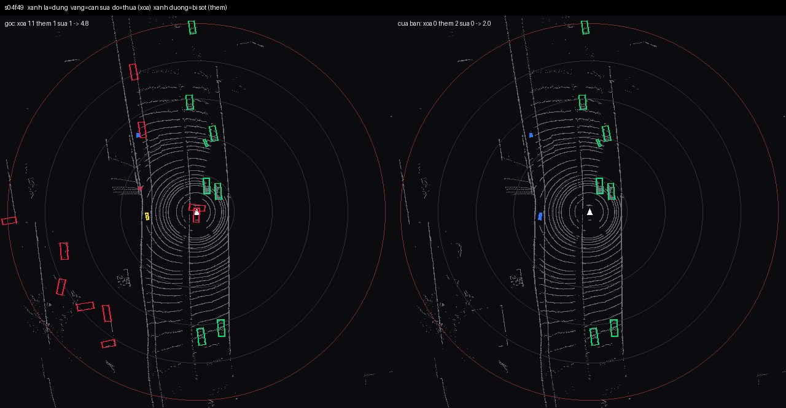

# Báo cáo Day 14 — Nguyễn Văn Quang — 2A202603200

- Mã học viên dùng với `--student`: `2A202603200`
- `seed_tag` trong `frames_A.txt`: `82ac3100fd`

## 1. Dự đoán trước sweep (bước 5b)

Ghi **trước** khi chạy `scripts/pp_sweep.py`, rồi commit và push ngay (lịch sử commit là bằng chứng thời điểm viết). Không sửa phần này sau khi có kết quả.

- Tham số tôi nghĩ giảm công sửa nhiều nhất: **`score_thr`**, tăng từ 0.1 lên khoảng **0.3–0.4**. `min_points` gần như không giúp được (dự đoán `min_points` = 0 hoặc 5 cho kết quả tương đương).
- Vì sao (nhìn ảnh BEV tập A: box thừa nhiều hay box sót nhiều?):
  - Tập A chủ yếu là **box thừa**: với cấu hình gốc, trong 50 m tôi phải xóa 48 box, chỉ thêm 5 và sửa 6 (chi phí 22.4). Phần xóa chiếm 14.4/22.4 chi phí.
  - Box thừa phần lớn nằm trên bụi cây, dải phân cách và hàng rào ven đường (nhiều "Cyclist" xếp thẳng hàng ở s03f44), cộng với box nằm ngay trên xe thu dữ liệu (r ≈ 1 m).
  - Box tôi xóa có score thấp hơn rõ: trung vị 0.34, so với 0.84 ở box tôi giữ. Box giữ thấp nhất là 0.30. Vì vậy ngưỡng 0.3 bỏ được khoảng 18 box thừa mà không mất box đúng; ngưỡng 0.4 bỏ được khoảng 30 box thừa nhưng mất khoảng 4 box đúng (mỗi box mất thành 1 lần "thêm").
  - `min_points` không tách được hai nhóm, vì box thừa trên bụi cây vẫn có nhiều điểm (trung vị 80 điểm): `min_points=10` chỉ bỏ được khoảng 3 box thừa và đã mất 1 box đúng ở xa.
  - Rủi ro: chỉ có 3 frame, nên ngưỡng tốt trên tập A có thể không giữ được trên tập B.

## 2. Tập A: sửa tay và tune

| Cấu hình | Xóa | Thêm | Sửa | Chi phí |
|---|---:|---:|---:|---:|
| Gốc | 48 | 5 | 6 | 22.4 |
| `best_config.json` | 9 | 12 | 3 | 16.2 |

- Tham số đã đổi trong `best_config.json`: `score_thr` 0.1 → **0.5**; `min_points` giữ **0**. Các tham số khác giữ mặc định.
- Kết quả leave-one-out (dán các dòng `scripts/pp_sweep.py` in ra):

  ```text
  s03f44: cấu hình chọn {'score_thr': '0.5', 'min_points': '0'} → 7.1 (tốt nhất có thể 6.5)
  s04f49: cấu hình chọn {'score_thr': '0.5', 'min_points': '0'} → 2.0 (tốt nhất có thể 2.0)
  s05f14: cấu hình chọn {'score_thr': '0.3', 'min_points': '0'} → 8.1 (tốt nhất có thể 7.1)
  ```

- Cấu hình có ổn định trên từng frame không? Vì sao tôi vẫn chọn (hoặc không chọn) nó:
  - **Ổn định một phần.** 2/3 lần bỏ một frame ra, phần còn lại vẫn chọn `score_thr=0.5`; riêng khi bỏ s05f14 thì cấu hình chọn được là 0.3. Trên frame bị bỏ ra, cấu hình được chọn chỉ kém mức tốt nhất 0–1.0 điểm chi phí, nên hướng "tăng `score_thr`" là chắc chắn, còn con số 0.3 hay 0.5 thì chưa chắc.
  - **`min_points` không có tác dụng**: ở cùng `score_thr`, 0/5/10 cho chi phí bằng nhau hoặc tệ hơn (ví dụ 0.3: 17.0 → 18.0).
  - **Chênh lệch giữa 0.3, 0.4, 0.5 rất nhỏ** (17.0 / 16.9 / 16.2) nhưng bản chất khác nhau: 0.5 bớt xóa (48 → 9) nhưng tăng thêm (5 → 12), tức là lọc mất 7 vật thật mà tôi phải vẽ lại. 0.3 thì không mất vật nào (thêm vẫn 5) và giảm xóa 48 → 30.
  - Tôi vẫn dùng `best_config.json` (0.5) cho tập B vì đó là cấu hình có chi phí thấp nhất trên tập A theo công thức của lab, nhưng chấp nhận rủi ro: trên tập B, nếu có nhiều vật thật score 0.3–0.5 thì phải vẽ thêm nhiều hơn.

## 3. Trước/sau (bước 8)



| Frame | Chi phí gốc | `best_config.json` |
|---|---:|---:|
| s03f44 | 9.5 | 7.1 |
| s04f49 | 4.8 | 2.0 |
| s05f14 | 8.1 | 7.1 |
| **Tổng** | **22.4** | **16.2** |

- `scripts/pp_compare.py` báo **giảm 28%** công sửa trên tập A (22.4 → 16.2), chỉ đổi `score_thr` 0.1 → 0.5.
- Ảnh s04f49 (trái: gốc, phải: đã tune): cấu hình gốc phải xóa 11 box đỏ, gồm box nằm ngay trên xe thu dữ liệu ở tâm và một loạt box ở ngoài mép đường bên trái (vùng cây, vỉa hè). Với `score_thr=0.5`, toàn bộ 11 box thừa này biến mất và mọi box xanh lá (đúng) vẫn được giữ. Đổi lại, box vàng (cần sửa) ở mép đường bị lọc mất, thành 1 box phải thêm (xanh dương), cộng 1 box vốn đã sót. Chi phí frame này giảm 4.8 → 2.0.
- Dự đoán ở mục 1 đúng hay sai? Giải thích bằng số box xóa/thêm/sửa:
  - **Đúng về tham số và hướng:** tăng `score_thr` là thứ giảm công sửa; `min_points` gần như không tác dụng (ở cùng `score_thr`, `min_points` 5/10 cho chi phí bằng hoặc cao hơn 0).
  - **Lệch về giá trị:** tôi đoán 0.3–0.4, sweep chọn 0.5. Ở 0.3 chi phí 17.0 (xóa 30, thêm 5, sửa 6), không mất vật thật nào. Lên 0.5 thì xóa giảm mạnh 48 → 9 (tiết kiệm 11.7 điểm) trong khi thêm tăng 5 → 12 (tốn thêm 7 điểm); vì trọng số xóa (0.3) nhỏ hơn thêm (1.0) nhưng số box thừa quá nhiều, nên ngưỡng cao vẫn có lợi hơn tôi nghĩ.
  - Tôi đã đoán đúng rằng ngưỡng 0.4 sẽ làm mất vật thật (thực tế 0.4 thêm 9, 0.5 thêm 12), nhưng đánh giá thấp lượng box thừa có score 0.3–0.5 nên chọn ngưỡng thấp hơn mức tối ưu.

## 4. Tập B

Số đo từ `scripts/pp_prelabel.py --frames d14_2A202603200/frames_B.txt --config d14_2A202603200/best_config.json --gt d14_2A202603200/ref_B.json`:

| Xóa | Thêm | Sửa | Chi phí |
|---:|---:|---:|---:|
| 51 | 33 | 4 | 50.3 |

12 frame, trong 50 m: GT 159 box, dự đoán 177 box, khớp 126. Chi phí trung bình 4.2/frame (tập A với cùng cấu hình: 5.4/frame).

| Frame | Xóa | Thêm | Sửa | Chi phí |
|---|---:|---:|---:|---:|
| s01f09 | 4 | 2 | 1 | 3.7 |
| s01f36 | 5 | 1 | 1 | 3.0 |
| s01f52 | 3 | 1 | 0 | 1.9 |
| s02f02 | 5 | 1 | 0 | 2.5 |
| s02f37 | 5 | 6 | 0 | 7.5 |
| s02f54 | 9 | 1 | 0 | 3.7 |
| s03f01 | 1 | 3 | 0 | 3.3 |
| s03f23 | 3 | 6 | 0 | 6.9 |
| s03f58 | 6 | 2 | 0 | 3.8 |
| s05f05 | 7 | 3 | 0 | 5.1 |
| s05f23 | 2 | 2 | 1 | 3.1 |
| s05f43 | 1 | 5 | 1 | 5.8 |

- Loại box tốn công sửa nhất ở tập B: **box bị sót phải vẽ thêm** — 33 box × 1.0 = 33.0/50.3 điểm (khoảng 66% chi phí), dù số box phải xóa nhiều hơn (51 × 0.3 = 15.3).
  - Box phải thêm (đếm gần đúng theo lớp): Car ~10, Cyclist ~9, **Truck ~6, Pedestrian ~6, Bus ~3**. Truck/Bus không có trong KITTI nên model gần như không tự sinh ra được; Pedestrian/Cyclist bị `score_thr=0.5` lọc bớt.
  - Box phải xóa chỉ gồm Car (~31) và Cyclist (~21): vẫn là box thừa trên cây, dải phân cách và trên xe thu dữ liệu, giống tập A.
  - Hai frame tốn nhất (s02f37: 7.5, s03f23: 6.9) đều do thêm 6 box, đúng với rủi ro đã nêu ở mục 2: ngưỡng 0.5 làm tăng số vật bị sót.

## 5. Giới hạn

- **Chỉ tune trên 3 frame (tập A).** Cấu hình "tốt nhất" có thể chỉ khớp với 3 frame này; kết quả leave-one-out ở mục 2 cho thấy mức độ ổn định, nhưng 3 frame vẫn quá ít để kết luận chắc chắn.
- **Model học từ KITTI, khác miền dữ liệu VF.** KITTI chỉ có Car/Cyclist/Pedestrian, không có Truck/Bus; Truck/Bus chỉ được suy ra bằng luật kích thước nên dễ sai lớp. LiDAR và cảnh đường phố VF cũng khác KITTI, nên model sinh nhiều box thừa trên bụi cây, dải phân cách và trên chính xe thu dữ liệu.
- **Chi phí sửa là công thức (0.3·xóa + 1.0·thêm + 0.5·sửa), chưa phải thời gian sửa thật.** Trọng số do lab đặt; thời gian thực tế phụ thuộc người gán nhãn và giao diện CVAT.
- **Chỉ tính box trong bán kính 50 m.** Box tôi thêm ngoài 50 m (ví dụ Car 57.8 m và Bus 68.1 m ở s03f44) không được tính vào chi phí.
- **Nhãn tham chiếu do chính tôi sửa**, không phải nhãn chuẩn của coach, nên có thể còn sót hoặc sai; tune theo nhãn này sẽ mang theo sai số đó.
